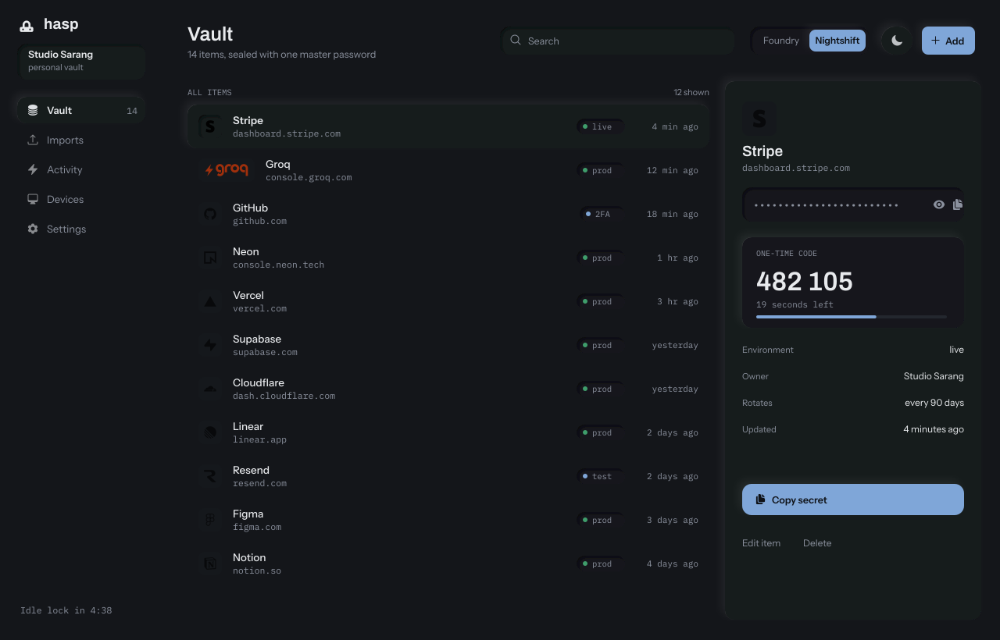
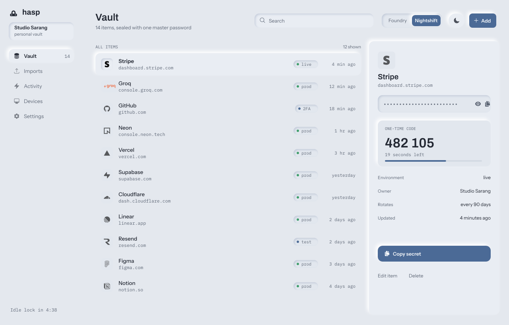
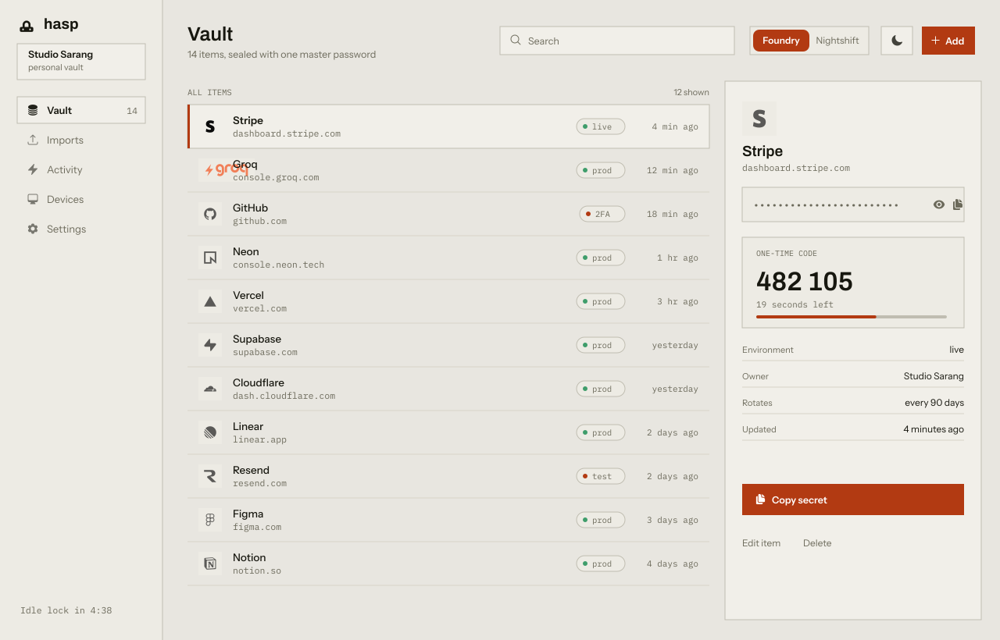
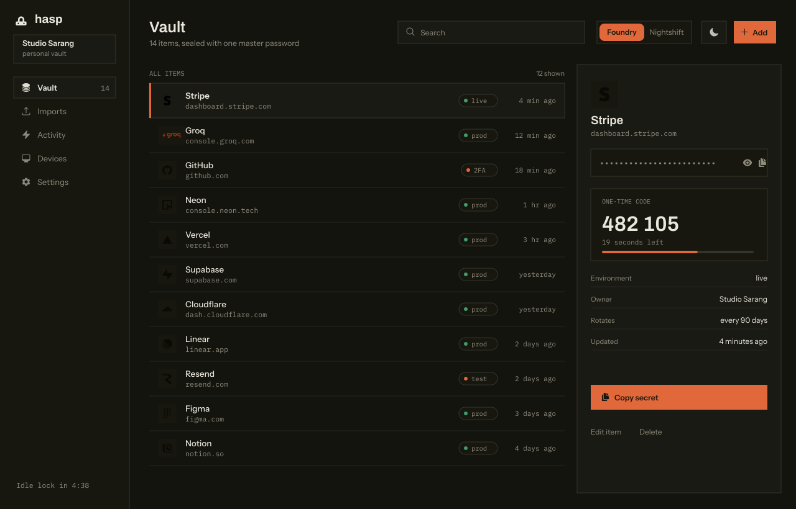

<div align="center">


**The keys you actually use, in one sealed place.**

A local-first vault for API keys, backup codes and one-time codes.<br>
Nightshift and Foundry. Light and dark. One master password.

[Run it](#run-it) · [The four surfaces](#the-four-surfaces) · [What works](#what-actually-works) · [What does not](#what-does-not-work-yet)

</div>

---



<div align="center"><sub><b>Nightshift, dark.</b> The default surface. Neumorphism without visible borders.</sub></div>

## Two products in one

Direction and mode are independent: four surfaces, one set of components, and only
the tokens change.

|  | Light | Dark |
| --- | --- | --- |
| **Nightshift** |  |  |
| **Foundry** |  |  |

**Nightshift** is neumorphism kept legible. There are no visible borders anywhere.
Every control is the same colour as the surface and is drawn with a paired light
and dark shadow, so fields and chips read as pressed *into* the panel and buttons
as raised *out* of it. The accent appears on selection and focus only.

**Foundry** is a parts catalog. Square corners, one-pixel rules, a solid ink table
header, one oxide accent on the active row. Structure does the work.

Both clear WCAG 2.1 AA for text, and `test/theme.test.mjs` parses
`src/web/tokens.css` and fails the build when any of the four combinations drops
below the floor. The palette cannot drift quietly.

## Run it

```
npm install
npm start            # http://localhost:3000
npm test             # 480 cases
```

Node 22 or newer. No database, no environment variables, no network at runtime.

- `/` is the vault. The sample password is `foundry-nightshift-2026`, filled in.
- `/themes.html` shows all four surfaces at once, rendered from the real components.

**This is a sample build.** Every item in the vault is invented, and every sample
value is worded as an example on purpose. Do not put a real secret in it until
you have read [What does not work yet](#what-does-not-work-yet).

## What actually works

**Vault.** Create, edit, delete, restore, search, filter by type and environment,
copy with a 30 second clipboard clear, reveal, rotate with version history.

**Encryption.** scrypt key derivation with recorded parameters, a random vault key
wrapped by the password key, per-item keys derived from the vault key, and item
ciphertext bound to its vault, id and version as associated data, so a ciphertext
moved to another row fails to open rather than opening as something else.

**One-time codes.** RFC 6238 TOTP over RFC 4226 HOTP, with base32 and `otpauth://`
parsing, checked against the RFC's own vectors. A depletion bar shows the period.

**Backup codes.** Code sets with unused counts, per-code copy, and no "copy all"
affordance, because copying a set is how sets end up in a chat log.

**Import.** Google Keep JSON and HTML, CSV, and `otpauth://` URIs, with confidence
scoring and a review step. A parsed import is single use and expires after 30
minutes.

**Search that does not store your words.** A blind index: queries match on keyed
hashes, so the vault never holds the plaintext of what you searched for.

## What does not work yet

Stated plainly, because the header above says "sealed" and that word has a floor.

- **No accounts, no sharing, no account recovery.** A password you lose is a vault
  you lose. There is no party that can reset it, which is the point and also the
  cost.
- **Sync has a command line and a panel, and no background process.** `npm run sync`
  runs one pull on a second machine. Nothing schedules it. If you want two machines
  kept level, run it, or put it in cron. A machine that has never held the vault file
  cannot start, because sync moves ciphertext between copies of one vault and does
  not create the first copy.
- **Sync is a file, not a service.** `src/sync/` moves ciphertext between your own
  machines. It is off until you start it, and it keeps the vault id, record ids,
  revisions, timestamps, item types and the blind index. It cannot read a name or a
  value, because it has no key. A store token is a write credential: whoever holds
  it can write junk into your vault, though not read it.
- **The phone app is a client, not a vault.** It shows one-time codes, pairs over
  plain HTTP on a local network, and needs the desktop machine awake. See
  `mobile/README.md`.
- **The cipher is `chacha20-poly1305` with a 12-byte nonce, not the planned
  XChaCha20-Poly1305.** `src/core/crypto.js` says so at the top. Replace it with
  libsodium before a real secret goes in.
- **No independent crypto review.** Tested, not audited.
- **Passkey unlock is a stub.** It renders and stores nothing.
- **The screenshots are generated, not captured.** `tools/render.mjs` draws them
  from the real tokens and the real typefaces, but it draws the layout rather than
  running the app. The images in `docs/screens` are 1280x820, which is the
  renderer's own default, so they came from that path and not from a browser.
  `npm run png` captures the real app at 1400x900 when a browser is available.

## Layout

```
server.mjs            one node:http server, static files + JSON API, no dependencies
src/core/             kdf, crypto, wrap, vault, totp, backup codes, parsers, seed
src/web/              the client: tokens, components, app, themes page, brands, fonts
src/web/heroicons/    vendored Heroicons solid, MIT, licence beside them
test/                 480 cases: crypto, TOTP, parsers, contrast, API, and the real client in jsdom
tools/                icon and brand generation, the renderer, the Playwright capture
docs/BRAND.md         the identity: mark, wordmark, colour, clear space
```

The client has **no runtime dependencies** and no CDN. Icons are inlined from the
vendored set, fonts are served from `src/web/fonts`, and the 586 company marks are
local SVGs. It works with the network unplugged.

## Security, honestly

Full detail in [SECURITY.md](SECURITY.md), including the threat model and the parts
that are deliberately out of scope.

- Sessions hold the vault key in process memory with an idle lock; the key is never
  written to disk.
- The cookie is `HttpOnly; SameSite=Strict; Path=/`. Cross-origin POSTs are refused.
- CSP is `default-src 'self'`, with `nosniff`, `DENY` and `no-referrer`.
- Path traversal is refused, including encoded forms.
- Wrong password returns 401 and renders inline. It does not reload the page.

Tests cover each of those. None of it substitutes for the review listed above.

## Licence

MIT for the code. Heroicons is MIT, Tailwind Labs, vendored under
`src/web/heroicons/LICENSE`. Company marks under `src/web/brands` belong to their
owners and are used to label the accounts they identify.
