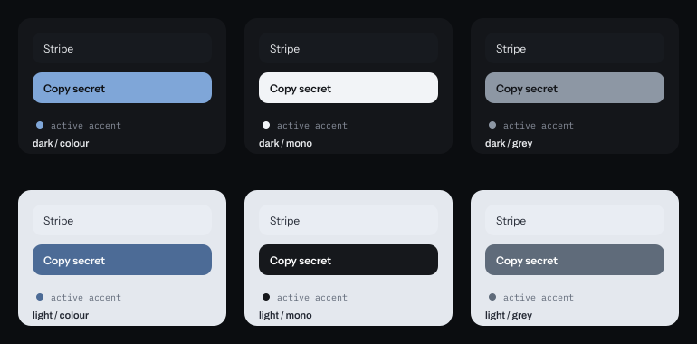

# Hasp identity

Everything here is generated from `tools/mark.mjs` and `tools/wordmark.mjs`.
Nothing is hand-exported, so the favicon, the app icon, the README logo and the
social banner cannot drift apart. Run `npm run render` to regenerate all of it.

## The mark

A hasp is a hinged plate that a padlock closes over: the metal fitting on a
shutter, a locker door, a flight case. The mark is that object seen front on.

```
    shackle
   ╭───────╮
   │       │
  ▟█████████▙
  ███ ●   ● ███      plate, with two bolt holes
```

**The bolt holes are the point.** A plain padlock is a stock glyph that a hundred
other security products already use. A padlock with bolts in its body reads as
*hardware*, not as an app, and it says "this is fitted and shut" rather than "this
is locked". The holes also give the mark something to be recognised by at small
sizes, which a padlock's flat body does not.

It holds at 16px. Below about 20px the bolts are two dots and the shackle is a
filled arch, and the silhouette is still recognisably a lock and not a circle.

## The wordmark

`hasp` is set lowercase in **Archivo SemiBold (600–700)**, the same face the
interface uses for headings. Lowercase because the product is small and quiet;
capitalisation would make it shout. The letterforms are converted to outlines and
shipped as paths, so the logo renders on GitHub, in an email and in a README
without a webfont request.

## Colour

| Token | Hex | Use |
| --- | --- | --- |
| Ink | `#14161a` | Icon ground, text on light |
| Plate | `#e8eaed` | The mark on a dark ground |
| Signal | `#7fa6d8` | The Nightshift accent; used sparingly |
| Oxide | `#b23a12` | The Foundry accent; never beside Signal |

Two accents, one per direction, and they never appear together. That is the whole
colour system; everything else is a grey from `src/web/tokens.css`.

## Accent styles

The accent is a third axis, set by `data-accent` on `:root`, on top of direction
and mode.

| Style | Light | Dark | Use |
| --- | --- | --- | --- |
| `colour` (default) | the direction's own hex | the direction's own hex | The identity above |
| `mono` | `#16181c` | `#f2f4f7` | No hue at all |
| `grey` | `#5f6b7a` | `#8d97a4` | Present but not pulling |



`colour` is the default and the one this document specifies. The other two exist
because a surface sometimes has to carry no colour, and a colour that fails
contrast is not a style choice: every pair is measured in `test/theme.test.mjs`.

## Files

| File | Size | Use |
| --- | --- | --- |
| `docs/screens/social.png` | 1280×640 | GitHub social preview |
| `docs/screens/icon-512.png` | 512×512 | App icon, store listing |
| `src/web/apple-touch-icon.png` | 180×180 | iOS home screen |
| `src/web/favicon.svg` | 128 vector | Browser tab |
| `docs/screens/icon.svg` | 128 vector | Any square slot |
| `docs/screens/logo.svg` | outlined | Light grounds |
| `docs/screens/logo-dark.svg` | outlined | Dark grounds |

## Clear space

Keep a margin of one bolt-hole width (6 units on the 128 grid, so roughly 5% of
the mark's width) clear on every side. At icon sizes, do not add a second ring or
a border: the ground is part of the mark.

## Don't

- Don't put the mark on a gradient that is not `--ground`. The relief already has
  one.
- Don't outline the plate. The mark is solid; a stroke makes it a different mark.
- Don't set the wordmark in anything but Archivo, and don't re-space `hasp` by hand.
- Don't place the Signal blue on the Oxide red. They belong to different surfaces.
